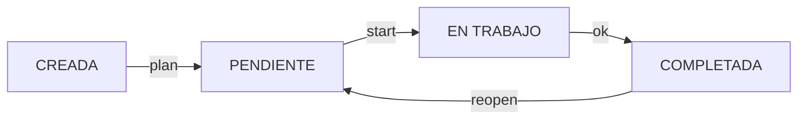
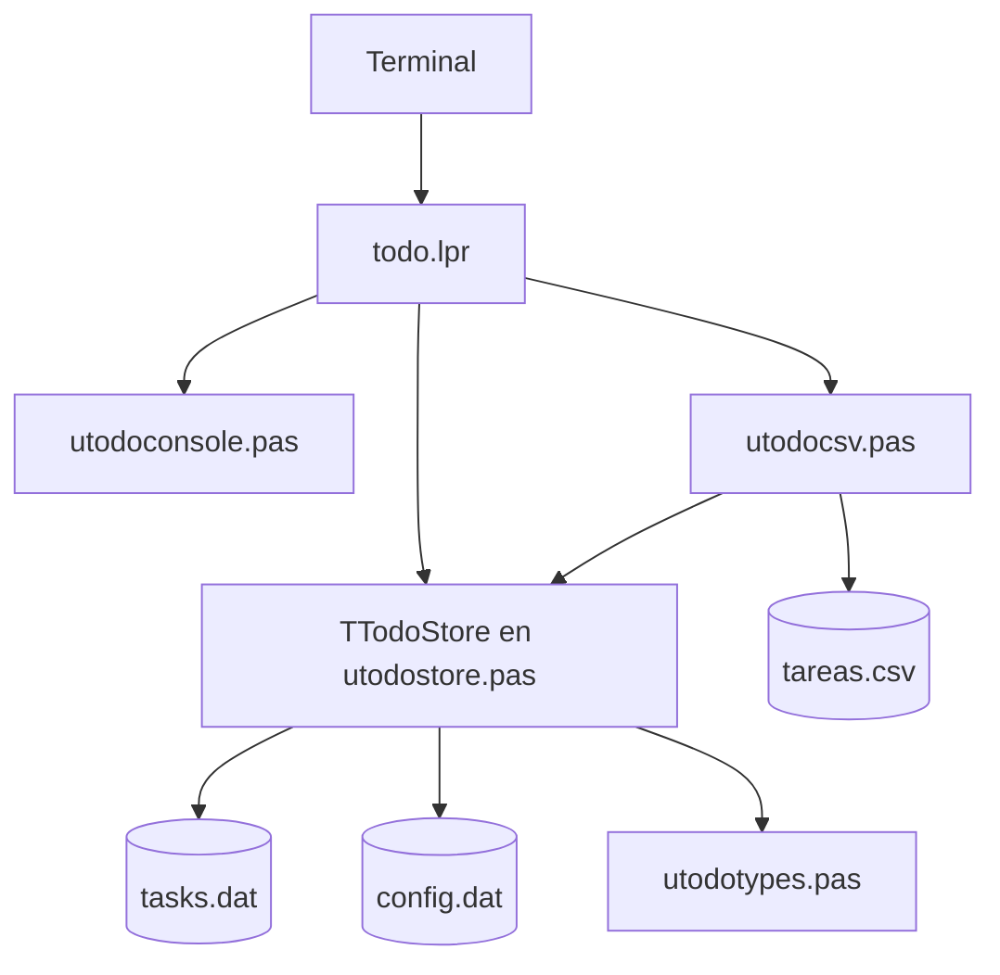

# TODO — Gestor de tareas Kanban para terminal

**TODO** es un gestor local de tareas para Linux, escrito en Free Pascal (Object Pascal) y desarrollado con Lazarus. Organiza las tareas con un flujo Kanban de cuatro estados, prioridades, categorías y fechas. El archivo binario `tasks.dat` sigue siendo el almacenamiento principal; la importación y exportación CSV permiten trasladar tareas sin cambiar ese diseño.

El proyecto también sirve para practicar registros, enumerados, clases, arrays dinámicos, archivos tipados y separación de responsabilidades en Free Pascal.

## Características

- Estados **CREADA**, **PENDIENTE**, **EN TRABAJO** y **COMPLETADA**.
- Límite WIP configurable de 1 a 1000 tareas simultáneas (3 inicialmente), persistente en `config.dat`.
- Alta interactiva o directa, edición, borrado individual o por lotes y cambios de estado.
- Prioridades baja, media y alta, categorías libres y vencimiento opcional.
- Registro de fechas de creación, primer inicio y finalización.
- Listados por estado, categoría o prioridad; tablero, estadísticas y detalle.
- **Feature 02:** exportación e importación CSV UTF-8, con validación de datos y WIP.
- Persistencia binaria local, sin base de datos, y salida ANSI desactivable mediante `NO_COLOR=1`.
- Datos de prueba aislados mediante `XDG_DATA_HOME`.

## Requisitos

Linux, Free Pascal Compiler (FPC) y una terminal UTF-8. Lazarus es opcional para edición y depuración. No requiere Python, Docker, bases de datos ni dependencias de terceros.

## Compilación e instalación

```bash
git clone https://github.com/WalexNet/todo_kanban_cli.git
cd todo_kanban_cli/src
fpc -B todo.lpr
./todo help
./todo board
```

Para instalarlo en el directorio del usuario:

```bash
mkdir -p ~/.local/bin
install -m 755 todo ~/.local/bin/todo
type -a todo
```

Es necesario que `~/.local/bin` figure en `PATH`. Si hay otro comando llamado `todo` instalado, `type -a` permite comprobar cuál se ejecuta.

En una instalación Manjaro con FPC 3.2.2 y GCC 16, las advertencias por `crtbeginS.o` y `crtendS.o` pueden requerir indicar el directorio de los objetos de GCC:

```bash
fpc -B -Fl"$(dirname "$(gcc -print-file-name=crtbeginS.o)")" todo.lpr
```

Este ajuste corresponde a ese entorno y no es un requisito general.

## Uso rápido

### Crear y consultar

```bash
todo add
todo add "Revisar configuración BGP"
todo add "Preparar laboratorio OSPF" alta Redes
todo add "Revisar backups" media Sistemas --due 2026-12-01

todo                            # Equivale a todo ls
todo ls                         # Sin completar
todo ls creada
todo ls pendiente
todo ls trabajo
todo ls ok
todo ls all                    # Todas
todo ls all --cat Redes --priority alta
todo board
todo board --cat Sistemas
todo show 3
todo cats
todo stats
```

Las nuevas tareas empiezan en `CREADA`, con prioridad `media` y categoría `General` cuando no se especifican otros valores. Para indicar categoría en el alta directa también se debe indicar la prioridad.

### Flujo Kanban



```bash
todo 3 plan
todo 3 start
todo 3 ok
todo 3 reopen

todo move 3 creada
todo move 3 pendiente
todo move 3 trabajo
todo move 3 ok
```

`move` permite avanzar o retroceder, excepto repetir el estado actual. `reopen` se aplica únicamente a tareas completadas. Entrar en `EN TRABAJO` requiere capacidad WIP disponible.

### Configurar el límite WIP (Feature 01)

```bash
todo wip             # Consultar ocupación y plazas
todo wip set 5       # Fijar el límite en 5
todo wip reset       # Restaurar el valor inicial de 3
```

El límite válido está entre 1 y 1000 y se almacena en `config.dat`. Si se reduce por debajo del número de tareas en trabajo, estas conservan el estado; se bloquean nuevas entradas hasta liberar capacidad.

### Editar y borrar

```bash
todo edit 3
todo rm 4
todo rm 2 4-7 10
todo rm 2,4,6 --yes
```

La edición interactiva conserva el valor con `Enter`; `-` restaura la categoría `General` o elimina el vencimiento según el campo. El borrado comprueba todos los IDs antes de retirar tareas.

## Intercambio CSV (Feature 02)

```bash
todo export tareas.csv
todo import tareas.csv
```

`export` crea un CSV con **todas** las tareas y no sobrescribe un archivo que ya exista. `import` añade los registros al almacén actual tras validar el archivo completo y comprobar el WIP resultante. Los IDs del CSV no se reutilizan: se asignan nuevos identificadores para evitar conflictos. Por tanto, repetir una importación puede duplicar tareas.

**El CSV no reemplaza `tasks.dat`, no cambia su formato y no incluye `config.dat`.** No debe considerarse un respaldo completo de la aplicación.

### Formato CSV

Se utiliza UTF-8, separador `;`, cabecera obligatoria y nueve columnas en orden fijo:

```csv
id;descripcion;categoria;fecha_creacion;fecha_inicio;fecha_finalizacion;fecha_vencimiento;prioridad;estado
1;Preparar laboratorio BGP;Redes;2026-10-27T11:45:09.874;2026-10-27T11:46:43.297;2026-10-27T11:47:22.094;;alta;ok
```

Las fechas usan `YYYY-MM-DDTHH:MM:SS.mmm`. Las fechas opcionales sin valor se representan con campos vacíos. Las prioridades válidas son `baja`, `media` y `alta`; los estados CSV son `creada`, `pendiente`, `trabajo` y `ok`.

El formato maneja comillas dobles, puntos y coma y caracteres UTF-8. La descripción admite hasta 2047 bytes y la categoría hasta 63 bytes UTF-8. **No se admiten saltos de línea ni NUL** en descripciones y categorías, aunque un CSV pueda representar campos multilínea. Si hay datos inválidos o se supera el WIP, se cancela todo el lote de importación.

### Probar una importación sin alterar los datos reales

```bash
mkdir -p /tmp/todo-import-lab
XDG_DATA_HOME=/tmp/todo-import-lab ./todo path
XDG_DATA_HOME=/tmp/todo-import-lab ./todo import tareas.csv
XDG_DATA_HOME=/tmp/todo-import-lab ./todo ls all
```

Los comandos anteriores se ejecutan desde `src/`. Si `todo` está instalado en `PATH`, se puede omitir `./`.

## Almacenamiento

Por defecto, los archivos locales se encuentran en:

```text
~/.local/share/todo/
├── tasks.dat     # Cabecera y tareas en formato binario 2
└── config.dat    # Configuración de WIP: WIP=N (cuando se haya guardado)
```

```bash
todo path
NO_COLOR=1 todo board
```

`tasks.dat` emplea la firma `TODO-FPC-2`; el primer registro es una cabecera con versión y siguiente ID. Los registros siguientes contienen las tareas. `config.dat` es independiente; si no existe se utiliza WIP 3. La aplicación respeta `XDG_DATA_HOME`.

La escritura de tareas utiliza un archivo temporal `tasks.dat.tmp` y posterior renombrado. Está diseñada para uso personal local, no para varias instancias escribiendo simultáneamente; no proporciona bloqueo, transacciones ACID ni garantía de durabilidad ante un apagado repentino. Los archivos binarios anteriores a la versión 2 no se migran automáticamente.

## Estructura del proyecto

```text
todo_kanban_cli/
├── README.md
├── src/
│   ├── todo.lpr           # Punto de entrada y comandos
│   ├── utodotypes.pas     # Tipos, records y conversiones
│   ├── utodostore.pas     # Tareas, WIP y persistencia
│   ├── utodoconsole.pas   # Visualización y ayuda
│   └── utodocsv.pas       # Intercambio CSV
└── docs/
    ├── CHULETA.md
    └── INFORME.md
```



## Validación de la Feature 02

Se ha compilado con FPC 3.2.2. En un directorio de pruebas aislado se exportaron e importaron 11 tareas, conservando sus campos y fechas (incluidos los milisegundos), salvo los IDs reasignados. Se comprobó el rechazo por WIP excedido y por prioridad inválida, sin modificación del hash de `tasks.dat`; también se verificaron las comillas, el separador `;`, los caracteres UTF-8 y el rechazo de descripciones con saltos de línea.

## Estado y contribuciones

Aplicación funcional de aprendizaje y uso personal. Se admiten propuestas mediante *issues* y *pull requests*. Cualquier modificación futura del formato binario debe documentar su compatibilidad. La importación/exportación CSV y el WIP configurable no alteran la versión 2.

## Licencia

MIT License. Véase [LICENSE](LICENSE).
