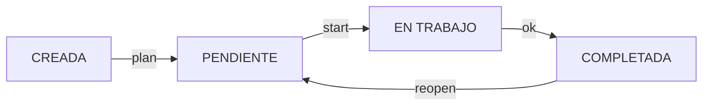
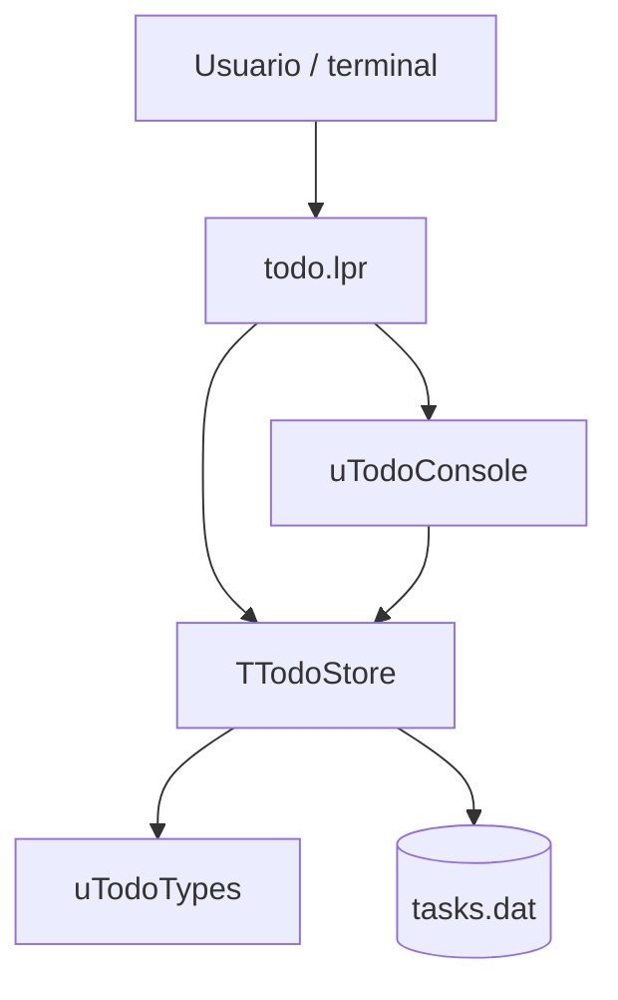

# TODO — Gestor de tareas Kanban para terminal

**TODO** es un gestor de tareas para la línea de comandos de Linux, desarrollado en **Free Pascal (Object Pascal)** con **Lazarus** como entorno de desarrollo. Permite organizar tareas mediante un flujo Kanban, asignar prioridades y categorías y conservar los datos localmente en un archivo binario, sin necesidad de una base de datos ni de servicios externos.

El proyecto también sirve como ejercicio práctico de programación estructurada y orientada a objetos en Free Pascal: registros, enumerados, clases, arrays dinámicos, archivos tipados y separación entre lógica de negocio e interfaz de consola.

## Características

- Tablero Kanban con cuatro estados: **CREADA**, **PENDIENTE**, **EN TRABAJO** y **COMPLETADA**.
- Límite de trabajo en curso (**WIP**) de tres tareas simultáneas.
- Alta de tareas en modo interactivo o directamente mediante argumentos.
- Prioridades **baja**, **media** y **alta**; categorías de texto libre.
- Fecha de vencimiento opcional y registro de fechas de creación, primer inicio y finalización.
- Listados filtrados por estado, categoría y prioridad.
- Consulta detallada, estadísticas y resumen por categorías.
- Edición y eliminación de múltiples tareas por ID o rango.
- Persistencia binaria local y salida ANSI en terminales compatibles.
- Compatibilidad con `NO_COLOR` y `XDG_DATA_HOME`.

## Requisitos

- Linux.
- **Free Pascal Compiler (FPC)** para compilar el proyecto.
- Lazarus es opcional, pero útil para abrir y depurar el proyecto desde un IDE.
- Una terminal compatible con UTF-8; los colores ANSI son opcionales.

No requiere Python, Docker, PostgreSQL ni bibliotecas de terceros.

## Compilación e instalación

Clona el repositorio y compila desde el directorio que contiene `todo.lpr`:

```bash
git clone <URL-DEL-REPOSITORIO>
cd <NOMBRE-DEL-REPOSITORIO>/src
fpc todo.lpr
```

Prueba el programa sin instalarlo:

```bash
./todo help
./todo board
```

Para instalarlo únicamente para tu usuario:

```bash
mkdir -p ~/.local/bin
install -m 755 todo ~/.local/bin/todo
```

Comprueba que `~/.local/bin` esté incluido en la variable `PATH` y ejecuta:

```bash
todo help
```

> Si existe otro ejecutable llamado `todo` en el sistema, comprueba cuál se está ejecutando mediante `type -a todo`.

## Uso rápido

### Crear tareas

```bash
todo add

todo add "Revisar configuración BGP"
todo add "Preparar laboratorio OSPF" alta Redes
todo add "Revisar copias de seguridad" media Sistemas --due 2026-12-01
```

Si no se especifica prioridad se utiliza `media`; la categoría predeterminada es `General`. Las tareas nuevas se crean en el estado **CREADA**. Para indicar una categoría mediante argumentos, también debes indicar la prioridad.

### Consultar tareas

```bash
todo                           # Tareas no completadas
todo ls                        # Tareas no completadas
todo ls creada                 # Tareas recién creadas
todo ls pendiente              # Tareas planificadas
todo ls trabajo                # Tareas en curso
todo ls ok                     # Tareas completadas
todo ls all                    # Todas las tareas

todo ls --cat Redes            # Filtrar por categoría
todo ls --priority alta        # Filtrar por prioridad
todo ls all --cat Redes --priority alta

todo board                     # Tablero Kanban
todo board --cat Sistemas      # Tablero filtrado
todo show 3                    # Detalle de una tarea
todo cats                      # Categorías y recuentos
todo stats                     # Estadísticas generales
```

### Cambiar el estado de una tarea

El flujo habitual es:



```bash
todo 3 plan       # CREADA -> PENDIENTE
todo 3 start      # PENDIENTE -> EN TRABAJO
todo 3 ok         # EN TRABAJO -> COMPLETADA
todo 3 reopen     # COMPLETADA -> PENDIENTE
```

También se pueden mover tareas directamente entre estados:

```bash
todo move 3 creada
todo move 3 pendiente
todo move 3 trabajo
todo move 3 ok
```

`move` permite avanzar o retroceder, pero no repetir el estado actual. `reopen` solo se aplica a tareas completadas. El programa impide que haya más de **tres** tareas simultáneamente en **EN TRABAJO**.

### Editar y eliminar

```bash
todo edit 3                # Editar una tarea de forma interactiva

todo rm 4                 # Eliminar una tarea con confirmación
todo rm 2 4-7 10          # Eliminar varios ID y un rango
todo rm 2,4,6 --yes       # Omitir confirmación
```

El borrado valida todos los identificadores del lote antes de efectuar cambios. Durante la edición, `Enter` mantiene el valor existente; `-` permite limpiar la fecha de vencimiento o restaurar la categoría predeterminada, según el campo.

## Ejemplo de sesión

```bash
todo add "Preparar laboratorio BGP" alta Redes
todo add "Revisar scripts de backup" media Sistemas
todo ls creada

todo 1 plan
todo 1 start
todo board
todo show 1

todo 1 ok
todo ls ok
todo stats
```

Los ID mostrados son ilustrativos: en una instalación existente pueden ser distintos.

## Almacenamiento

Las tareas se guardan por defecto en:

```text
~/.local/share/todo/tasks.dat
```

Puedes consultar la ubicación efectiva con:

```bash
todo path
```

El programa respeta `XDG_DATA_HOME`, lo que permite usar un almacén independiente para pruebas:

```bash
mkdir -p /tmp/todo-lab
XDG_DATA_HOME=/tmp/todo-lab todo add "Tarea de prueba" media Test
XDG_DATA_HOME=/tmp/todo-lab todo board
```

**Formato de datos:** el diseño Kanban utiliza el formato binario **versión 2**, identificado con la firma `TODO-FPC-2`. El primer registro es una cabecera con información de versión y el siguiente ID; el resto contiene las tareas. Los registros destinados a disco emplean campos de tamaño fijo, separados de los registros de memoria con cadenas dinámicas.

**Compatibilidad:** los archivos binarios de la versión anterior no se migran automáticamente. Antes de actualizar una instalación con datos reales, realiza una copia de seguridad de `tasks.dat`.

**Limitación:** el almacenamiento está pensado para uso local por una instancia a la vez. No implementa bloqueo entre procesos, transacciones ACID ni sincronización multiusuario.

## Estructura del código

```text
src/
├── todo.lpr           # Entrada principal y análisis de argumentos
├── utodotypes.pas     # Tipos, registros y conversión memoria/disco
├── utodostore.pas     # Gestión de tareas, estados y persistencia
└── utodoconsole.pas   # Presentación, tablero e interacción en consola
```

El programa separa la interfaz de línea de comandos de la persistencia:



`uTodoTypes` define los enumerados y los registros usados en memoria y en disco. `TTodoStore` encapsula el conjunto de tareas, las validaciones, el límite WIP y la lectura y escritura del archivo binario. `uTodoConsole` muestra los listados, el tablero y los mensajes. `todo.lpr` interpreta los argumentos y coordina las operaciones.

## Detalles técnicos

- **Lenguaje:** Object Pascal / Free Pascal.
- **Modelo de datos:** `record` para las tareas, `packed record` para la representación binaria y enumerados para estados y prioridades.
- **Persistencia:** `file of`, lectura/escritura de registros y guardado mediante archivo temporal antes del renombrado.
- **Identificadores:** los ID eliminados no se reutilizan.
- **Descripción:** hasta 2047 bytes UTF-8.
- **Categoría:** hasta 63 bytes UTF-8.
- **Fechas:** creación, primer inicio, finalización y vencimiento opcional.
- **Colores:** se pueden desactivar mediante `NO_COLOR=1`.

```bash
NO_COLOR=1 todo board
```

## Estado del proyecto

Proyecto funcional de aprendizaje y uso personal. Entre las posibles mejoras futuras se encuentran un tablero adaptable al ancho de la terminal, un historial de transiciones, bloqueo de acceso concurrente y mecanismos de migración entre versiones del archivo binario.

## Contribuciones

Se pueden proponer mejoras y correcciones mediante *issues* y *pull requests*. Para cambios que afecten al formato de almacenamiento, conviene documentar explícitamente la compatibilidad de los archivos existentes.

## Licencia

**Pendiente de definir.** Antes de distribuir el proyecto como software de código abierto, añade un archivo `LICENSE` con la licencia elegida. Publicar el código en GitHub no concede por sí solo permisos de reutilización, modificación o redistribución.
