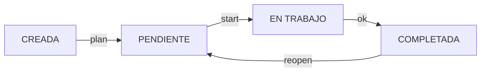

# TODO Kanban — Chuleta de comandos

Guía rápida del gestor de tareas de terminal escrito en **Free Pascal**. Los ejemplos asumen que `todo` está instalado y disponible en el `PATH`.

> Para consultar la ayuda implementada en la versión que tengas compilada: `todo help`.

## 1. Consultar tareas

```bash
todo                              # Equivale a: todo ls
todo ls                           # Todas las tareas no completadas
todo ls creada                    # Solo tareas CREADAS
todo ls pendiente                 # Solo tareas PENDIENTES
todo ls trabajo                   # Solo tareas EN TRABAJO
todo ls ok                        # Solo tareas COMPLETADAS
todo ls all                       # Todas las tareas, sin distinción de estado

todo board                        # Tablero Kanban con cuatro columnas
todo show 3                       # Detalle de la tarea #3
todo cats                         # Categorías y recuentos
todo stats                        # Estadísticas por estado y límite WIP
```

**Filtros disponibles:**

```bash
todo ls --cat Redes               # Tareas no completadas de Redes
todo ls trabajo --cat Redes       # Tareas en trabajo de Redes
todo ls --priority alta          # Tareas no completadas de prioridad alta
todo ls all --cat Redes --priority alta
                                  # Combina categoría y prioridad
todo board --cat Sistemas         # Tablero limitado a Sistemas
```

## 2. Crear tareas

```bash
todo add                          # Alta interactiva
todo add 'Revisar configuración BGP'
todo add 'Preparar laboratorio OSPF' alta Redes
todo add 'Revisar copias' media Sistemas --due 2026-12-01
```

- Estado inicial: **CREADA**.
- Prioridades: `baja`, `media` (predeterminada) y `alta`.
- Categoría predeterminada: `General`.
- Fecha de vencimiento opcional: `--due AAAA-MM-DD`.
- En alta directa, para indicar la categoría hay que especificar antes la prioridad.

## 3. Cambiar el estado de una tarea

Flujo habitual:

```bash
todo 3 plan                      # CREADA -> PENDIENTE
todo 3 start                     # PENDIENTE -> EN TRABAJO
todo 3 ok                        # EN TRABAJO -> COMPLETADA
todo 3 reopen                    # COMPLETADA -> PENDIENTE
```

También se puede mover una tarea directamente a otro estado:

```bash
todo move 3 creada
todo move 3 pendiente
todo move 3 trabajo
todo move 3 ok
```

Reglas principales:

- Máximo **3 tareas simultáneas EN TRABAJO** (`MAX_WIP = 3`). La cuarta no puede iniciarse mientras se mantenga ese límite.
- `move` admite avanzar o retroceder a un estado **distinto del actual**.
- `reopen` solo se aplica a tareas COMPLETADAS; vuelve a PENDIENTE.
- `StartedAt` registra el **primer inicio** de una tarea, aunque después cambie de estado.
- `CompletedAt` se registra al finalizar y se limpia al sacar la tarea de COMPLETADA.

## 4. Editar y eliminar

```bash
todo edit 3                       # Editar tarea de forma interactiva
todo rm 4                         # Eliminar tarea #4, con confirmación
todo rm 2 4-7 10                  # Eliminar varios ID y rangos
todo rm 2,4,6 --yes               # Eliminar varios ID sin confirmación
```

En la edición interactiva:

- `Enter` mantiene el valor actual.
- `-` en la categoría restablece `General`.
- `-` en la fecha de vencimiento elimina esa fecha.

El borrado valida **todos los ID del lote** antes de eliminar; si falta uno, rechaza la operación completa. Los identificadores eliminados **no se reutilizan**.

## 5. Ayuda, colores y archivos

```bash
todo help                         # Ayuda integrada
todo path                         # Ruta del archivo tasks.dat
NO_COLOR=1 todo board             # Desactivar colores ANSI
```

El archivo de datos se guarda normalmente en:

```text
~/.local/share/todo/tasks.dat
```

Se utiliza `XDG_DATA_HOME` si está definido. Para trabajar con un almacén de pruebas independiente:

```bash
mkdir -p /tmp/todo-pruebas
XDG_DATA_HOME=/tmp/todo-pruebas todo add 'Prueba' media Test
XDG_DATA_HOME=/tmp/todo-pruebas todo board
XDG_DATA_HOME=/tmp/todo-pruebas todo path
```

> **Precaución:** comprueba `todo path` antes de borrar archivos de datos. No incluyas `tasks.dat` ni datos personales de tus tareas en el repositorio GitHub.

## 6. Sesión de ejemplo

Los ID son ilustrativos: consulta el ID real asignado en tu instalación.

```bash
todo add 'Estudiar records en Pascal' media Desarrollo
todo add 'Preparar laboratorio BGP' alta Redes
todo ls creada

todo 2 plan
todo 2 start
todo board
todo show 2

todo 2 ok
todo ls ok
todo 2 reopen
todo board --cat Redes
todo stats
```

## 7. Estados del tablero



Este diagrama representa el **flujo habitual**. El comando `move` permite otros cambios entre estados, siempre que el destino sea distinto del actual y se respete el límite WIP.

## 8. Campos de una tarea

| Campo | Significado |
|---|---|
| `ID` | Identificador único y persistente |
| `Description` | Descripción (hasta 2047 bytes UTF-8) |
| `Category` | Categoría (hasta 63 bytes UTF-8) |
| `Priority` | Baja, media o alta |
| `Status` | Creada, pendiente, en trabajo o completada |
| `CreatedAt` | Fecha y hora de creación |
| `StartedAt` | Fecha y hora del primer inicio |
| `CompletedAt` | Fecha y hora de finalización vigente |
| `DueAt` | Fecha de vencimiento opcional |

## 9. Persistencia y compatibilidad

- Los datos se almacenan en un **archivo binario local** (`tasks.dat`), sin base de datos externa.
- La versión Kanban utiliza **formato binario 2**, identificado internamente como `TODO-FPC-2`.
- **No existe migración automática** del formato binario anterior. Conserva una copia de seguridad antes de sustituir una versión antigua.
- Las operaciones modificadoras guardan el estado tras el cambio. El diseño no incluye bloqueo para procesos simultáneos ni garantías de una base de datos transaccional.

## 10. Referencia rápida

| Necesidad | Comando |
|---|---|
| Añadir | `todo add` |
| Ver activas | `todo ls` |
| Ver todas | `todo ls all` |
| Ver terminadas | `todo ls ok` |
| Tablero Kanban | `todo board` |
| Planificar | `todo ID plan` |
| Iniciar | `todo ID start` |
| Completar | `todo ID ok` |
| Reabrir | `todo ID reopen` |
| Cambiar a cualquier otro estado | `todo move ID ESTADO` |
| Editar | `todo edit ID` |
| Ver detalle | `todo show ID` |
| Eliminar | `todo rm ID` |
| Categorías | `todo cats` |
| Estadísticas | `todo stats` |
| Ruta de datos | `todo path` |
| Ayuda | `todo help` |

---

Documentación del proyecto: consulta también `README.md` e `INFORME.md`.
