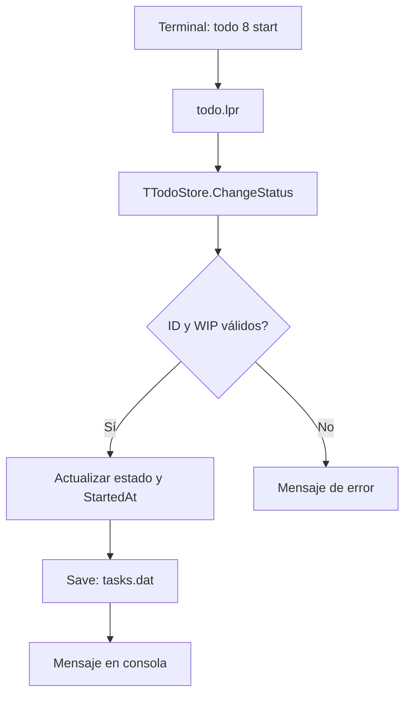
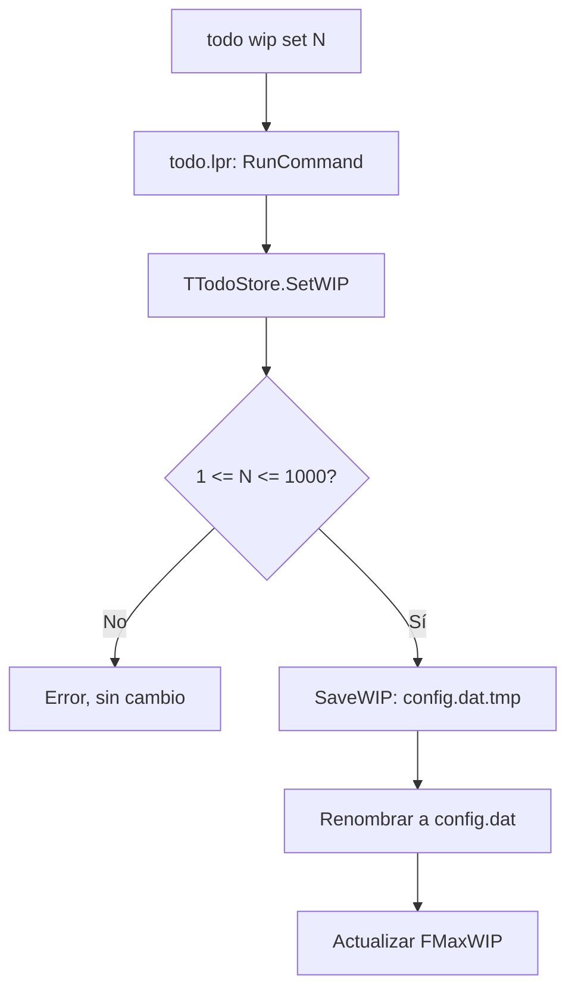

# Informe técnico: TODO Kanban (Free Pascal + Lazarus + Linux)

## 1. Objetivo y flujo general

TODO es un comando Linux que mantiene tareas en un archivo binario tipado. Cada ejecución carga las tareas en memoria, ejecuta la operación solicitada y, si hubo cambios, vuelve a guardar el estado completo en disco.

Flujo para `todo 8 start`:



La consola no manipula directamente el archivo. Todas las modificaciones pasan por `TTodoStore`.

## 2. Estados: modelo Kanban

- **CREADA**: registrada, todavía no planificada. Estado al ejecutar `add`.
- **PENDIENTE**: lista para abordarse.
- **EN TRABAJO**: en ejecución. Se admite como máximo el **WIP configurado** de tareas simultáneas (valor inicial: 3).
- **COMPLETADA**: terminada.

Las transiciones pueden avanzar o retroceder. `move` permite elegir cualquier estado distinto del actual. `plan`, `start` y `ok` son atajos; `reopen` solo se admite desde COMPLETADA y vuelve a PENDIENTE. La comprobación WIP está en la clase de datos y se aplica independientemente del comando. El valor se consulta con `todo wip`, se cambia con `todo wip set N` y se restablece con `todo wip reset` (rango 1..1000). Si el nuevo límite queda por debajo de la ocupación actual, se conservan las tareas existentes y se impiden nuevas entradas a EN TRABAJO hasta liberar capacidad.

En una transición a EN TRABAJO, `StartedAt` recibe la fecha/hora **si todavía está a cero**: representa el primer comienzo, aunque luego vuelva a PENDIENTE. Al completar se registra `CompletedAt=Now`; al salir de COMPLETADA se borra `CompletedAt` para indicar que ya no está terminada.

Categoría, prioridad y estado son independientes. Una tarea de categoría `Redes` puede tener prioridad `Alta` y estado `CREADA`.

## 3. `src/utodotypes.pas`: tipos de datos

Define:

```pascal
TPriority = (prBaja, prMedia, prAlta);
TTaskStatus = (tsCreada, tsPendiente, tsEnTrabajo, tsCompletada);
```

Define dos registros:

```pascal
TTaskRecord = record
  ID: LongInt;
  Description, Category: string;
  CreatedAt, StartedAt, CompletedAt, DueAt: TDateTime;
  Priority: TPriority;
  Status: TTaskStatus;
end;
```

Este es el **modelo de memoria**: texto dinámico fácil de usar en Object Pascal, fechas `TDateTime` y enumerados legibles.

`TTaskDiskRecord = packed record ... end;` es el **modelo de almacenamiento**: sustituye las cadenas dinámicas por arrays de `AnsiChar` y los enumerados por `Byte`. Se puede guardar con `file of TTaskDiskRecord` porque no contiene cadenas administradas ni punteros a datos externos. Las funciones `EncodeTask` y `DecodeTask` traducen entre ambos modelos.

`packed record` evita bytes de relleno por alineación entre los campos. No hace que un `string` dinámico sea seguro para almacenamiento binario: por eso mantenemos la separación de registros.

Longitud en disco: ID (4) + descripción (2048) + categoría (64) + cuatro campos `Double` (4x8) + prioridad (1) + estado (1) = **2150 bytes** por registro. En el diseño se asume el tamaño habitual de `LongInt`, `Double` y `Byte` con FPC en Linux. El constructor lo comprueba con `SizeOf`.

La codificación del texto es UTF-8, y los máximos se expresan en bytes, no en caracteres. Las constantes `DEFAULT_WIP = 3` y `MAX_ALLOWED_WIP = 1000` fijan el valor inicial y el máximo admitido, pero **no** el límite operativo, que se carga desde la configuración.

## 4. `src/utodostore.pas`: POO y persistencia

La clase `TTodoStore` encapsula:

- `FItems`: array dinámico de `TTaskRecord`.
- `FNextID`: próximo identificador persistente.
- `FFileName`: ubicación del archivo de tareas.
- `FConfigFileName`: ruta de `config.dat`.
- `FMaxWIP`: límite WIP vigente.

Funciones públicas: `Load`, `Count`, `Item`, `Find`, `Exists`, `Add`, `Edit`, `ChangeStatus`, `Complete`, `Reopen`, `CountByStatus`, `RemoveMany`, `SetWIP`, `ResetWIP`, y la propiedad de consulta `MaxWIP`. Los métodos privados `LoadWIP` y `SaveWIP` gestionan el archivo de configuración.

Detalles del almacenamiento:

1. `Load` abre `tasks.dat` como archivo de registros, comprueba firma y versión, y reconstruye las tareas mediante `DecodeTask`.
2. El **registro 0** actúa como cabecera; no es una tarea. Guarda la firma `TODO-FPC-2`, versión 2 y el siguiente ID. Los registros restantes son tareas.
3. `Save` crea `tasks.dat.tmp`, escribe primero la cabecera y después todas las tareas, cierra y renombra el archivo temporal.
4. Los ID eliminados no se reutilizan, porque se conserva `FNextID`.
5. `RemoveMany` valida todos los ID antes de borrar ninguno y admite rangos procesados por el programa principal.

La configuración es independiente del almacén binario:

```text
~/.local/share/todo/
├── tasks.dat    # Cabecera y registros de tareas (formato binario 2)
└── config.dat   # Una línea de texto: WIP=5
```

`TTodoStore` carga el valor WIP al crearse; si no existe `config.dat`, utiliza `DEFAULT_WIP = 3`. `SetWIP` valida el rango, guarda `config.dat.tmp`, lo renombra y actualiza el valor en memoria. `ResetWIP` escribe el valor inicial. Una configuración existente con contenido inválido se rechaza. La ruta respeta `XDG_DATA_HOME`, por lo que pueden realizarse pruebas en un directorio aislado.



Este almacenamiento resulta didáctico por utilizar `AssignFile`, `Reset`, `Read`, `Rewrite`, `Write`, `FileSize`, `CloseFile` y una clase. **No es un motor de base de datos**: no maneja escrituras simultáneas, transacciones ACID ni recuperación tras cortes eléctricos.

## 5. `src/utodoconsole.pas`: interfaz textual

Es responsable de `PrintHelp`, `PrintList`, `PrintBoard`, `PrintDetail`, `PrintCategories`, `PrintStats`, `PrintWIP`, `Prompt` y los mensajes.

El tablero agrupa las tareas en cuatro arrays por estado y dibuja columnas con el ID, prioridad, descripción abreviada y categoría. Usa secuencias de escape ANSI para colorear; `NO_COLOR=1` las desactiva. La presentación no cambia los registros de datos.

Los encabezados contienen caracteres UTF-8. `cwstring` en el programa principal habilita conversiones de codificación correctas en Linux, una corrección que ya fue necesaria durante las primeras pruebas con Lazarus.

## 6. `src/todo.lpr`: programa principal

Lee `ParamCount` y `ParamStr`. Comprueba los parámetros y llama a la clase o a la unidad de consola:

- `add` admite modo interactivo o argumentos directos.
- `ls` acepta estado opcional, filtro por categoría y filtro por prioridad.
- `board` presenta un resumen por columnas, opcionalmente filtrado por categoría.
- `move` y los atajos numéricos cambian estados.
- `rm` admite identificadores sueltos, rangos e ID separados por coma, con confirmación salvo `--yes`.
- `wip` consulta el límite y ocupación, `wip set N` lo modifica y `wip reset` lo restaura.
- `show`, `stats`, `cats`, `path` y `help` consultan datos. `path` y `help` pueden ejecutarse aunque el archivo de tareas todavía pertenezca a la versión anterior.

La gestión de excepciones presenta errores legibles y retorna código distinto de cero al shell.

## 7. Decisiones de diseño y límites

- Se ha **cambiado el formato a versión 2**. No se migran archivos de versiones anteriores porque estamos en pruebas.
- `ls` significa «no completadas»; `ls pendiente` se restringe al estado planificado.
- `StartedAt` mide la primera entrada en EN TRABAJO, no el tiempo total invertido.
- El WIP se configura en ejecución mediante `todo wip set N`, sin recompilar. `ChangeStatus` bloquea nuevas entradas a EN TRABAJO al alcanzar el límite.
- Todas las transiciones explícitas son posibles; se rechaza intentar pasar al estado actual. `reopen` requiere COMPLETADA.
- El tablero tiene ancho fijo pensado para terminal grande; faltaría detectar ancho de terminal para adaptar la salida.
- No se implementa todavía undo, estados bloqueados, histórico de transiciones, locking ni integración con Lazarus LCL.

## 8. Aprendizaje sugerido

Primero estudiar los dos `record` y la conversión `EncodeTask`/`DecodeTask`. Después seguir `TTodoStore.ChangeStatus` y `Save`. Finalmente recorrer `todo.lpr` y comprobar cómo un mismo método atiende `todo N start` y `todo move N trabajo`.

También resulta útil seguir `todo wip set 5` por `RunCommand`, `SetWIP`, `SaveWIP` y `config.dat`, y distinguir la persistencia textual de la persistencia binaria de tareas.

En Lazarus, un punto de interrupción en `TTodoStore.ChangeStatus` permite inspeccionar `OldStatus`, `ANewStatus`, `FItems[I].StartedAt`, `CompletedAt` y el resultado de `CountByStatus`.
