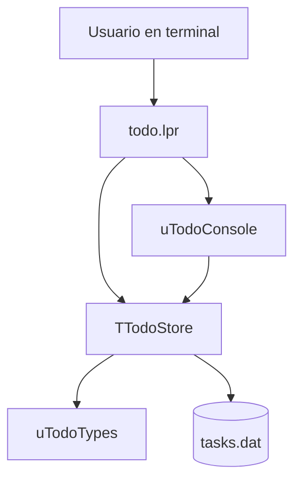
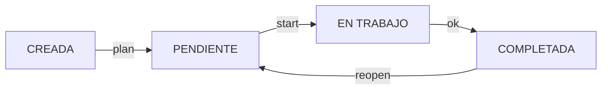
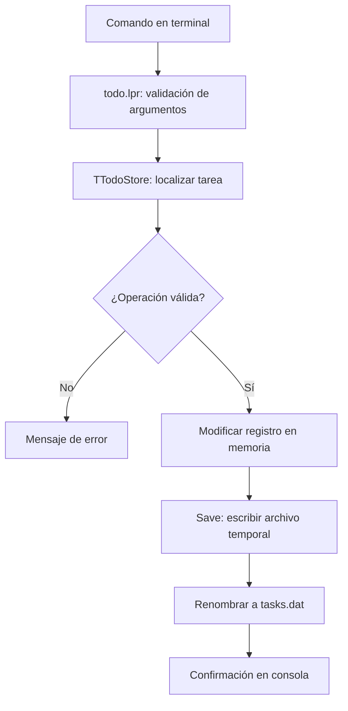
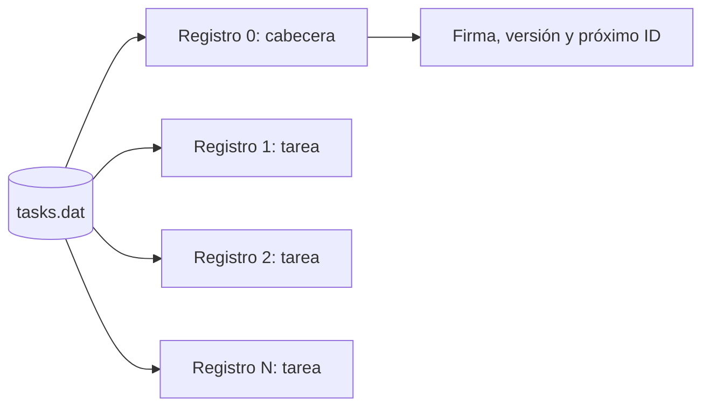

# Informe técnico — TODO Kanban

**Proyecto:** TODO, gestor de tareas para terminal Linux  
**Lenguaje:** Free Pascal / Object Pascal  
**Entorno de desarrollo:** Lazarus (opcional para compilación por consola)  
**Documentación:** versión Kanban con formato binario 2  
**Actualizado:** 10 de noviembre de 2026

## 1. Objetivo y alcance

TODO es una aplicación de línea de comandos que organiza tareas en un flujo Kanban y almacena sus datos localmente. Cada ejecución interpreta un comando, carga el almacén de tareas, realiza las consultas o modificaciones solicitadas y, cuando corresponde, guarda los cambios.

No necesita un servidor, una base de datos relacional ni dependencias externas. El diseño permite estudiar con un caso práctico la programación modular, la programación orientada a objetos y el trabajo con archivos binarios en Free Pascal.

La versión documentada incluye cuatro estados, prioridades, categorías, vencimientos opcionales, estadísticas y un límite de tres tareas en trabajo simultáneamente.

## 2. Organización del código

```text
src/
├── todo.lpr           # Programa principal y comandos
├── utodotypes.pas     # Tipos y conversión memoria/disco
├── utodostore.pas     # Reglas de negocio y persistencia
└── utodoconsole.pas   # Entrada/salida y vistas de consola
```



La separación de responsabilidades es deliberada:

- **`todo.lpr`** analiza `ParamCount` y `ParamStr`, valida los argumentos y decide qué operación ejecutar.
- **`uTodoTypes`** define enumerados, registros y conversiones de representación.
- **`uTodoStore`** mantiene las tareas en memoria, valida las transiciones y gestiona la lectura/escritura.
- **`uTodoConsole`** presenta listados, tablero Kanban, estadísticas, detalles y mensajes interactivos.

Las operaciones de negocio pasan por `TTodoStore`; la presentación no debe modificar directamente el archivo binario.

## 3. Modelo Kanban

Los estados son:

| Estado | Significado |
|---|---|
| `CREADA` | Tarea registrada que todavía no se ha planificado. |
| `PENDIENTE` | Tarea planificada y lista para comenzar. |
| `EN TRABAJO` | Tarea iniciada y actualmente en ejecución. |
| `COMPLETADA` | Tarea terminada. |

El flujo habitual se expresa así:



También existe `todo move ID ESTADO` para cambiar directamente a otro estado, incluso retroceder. Se rechaza un movimiento al estado que la tarea ya tiene. `reopen` solo se permite desde `COMPLETADA` y devuelve la tarea a `PENDIENTE`.

### 3.1 Límite WIP

El límite de trabajo simultáneo está configurado en `MAX_WIP = 3`. Antes de entrar en `EN TRABAJO`, la capa de almacenamiento comprueba cuántas tareas ocupan ese estado. Si ya hay tres, la operación se rechaza. Esta validación se aplica con independencia de que la transición se solicite mediante `start` o `move`.

### 3.2 Fechas asociadas al estado

- `CreatedAt`: fecha y hora de creación.
- `StartedAt`: primer momento en que la tarea entra en `EN TRABAJO`; no se reemplaza en inicios posteriores.
- `CompletedAt`: fecha y hora de finalización; al salir del estado `COMPLETADA` se limpia.
- `DueAt`: fecha de vencimiento opcional, independiente del estado.

Por tanto, `StartedAt` no sirve por sí solo para medir el tiempo efectivo dedicado a una tarea: el programa no acumula intervalos de trabajo.

## 4. Estructuras de datos: `uTodoTypes`

Los tipos principales son:

```pascal
TPriority = (prBaja, prMedia, prAlta);
TTaskStatus = (tsCreada, tsPendiente, tsEnTrabajo, tsCompletada);
```

El registro que utiliza la aplicación en memoria contiene los siguientes campos:

```pascal
TTaskRecord = record
  ID: LongInt;
  Description: string;
  Category: string;
  CreatedAt: TDateTime;
  StartedAt: TDateTime;
  CompletedAt: TDateTime;
  DueAt: TDateTime;
  Priority: TPriority;
  Status: TTaskStatus;
end;
```

`TTaskRecord` usa cadenas dinámicas y tipos cómodos para trabajar en Pascal. El archivo utiliza otra representación, `TTaskDiskRecord`, declarada como `packed record`, con arrays de `AnsiChar`, fechas serializadas como `Double` y enumerados representados por `Byte`.

Esta separación es necesaria: escribir directamente un registro con cadenas dinámicas grabaría referencias internas, no el contenido de esas cadenas. `EncodeTask` convierte un registro de memoria a su representación de disco; `DecodeTask` hace la conversión inversa.

Las longitudes máximas actuales son **2047 bytes UTF-8** para la descripción y **63 bytes UTF-8** para la categoría. Son límites en bytes, no en número de caracteres Unicode.

En el esquema documentado, cada registro de tarea ocupa 2150 bytes: 4 de ID, 2048 de descripción, 64 de categoría, cuatro fechas de 8 bytes y dos campos de 1 byte. Este cálculo depende de los tamaños de tipos previstos por el diseño para FPC en Linux.

## 5. Clase `TTodoStore`: lógica y persistencia

`TTodoStore` concentra el estado de la aplicación:

- `FItems`: array dinámico de tareas.
- `FNextID`: próximo identificador que se asignará.
- `FFileName`: ruta al archivo de datos.

La interfaz de la clase permite cargar y consultar tareas, añadirlas, editarlas, cambiar su estado, completarlas, reabrirlas, obtener recuentos y eliminarlas. Los métodos incluyen `Load`, `Count`, `Item`, `Find`, `Exists`, `Add`, `Edit`, `ChangeStatus`, `Complete`, `Reopen`, `CountByStatus` y `RemoveMany`.

### 5.1 Flujo de una modificación



Para `todo 8 start`, la operación localiza el ID, valida la transición y el límite WIP, establece `StartedAt` si no había fecha de primer inicio y guarda el resultado.

### 5.2 Formato binario versión 2

El almacén usa **`TODO-FPC-2`** como firma y la versión **2** como identificador de formato. El registro de índice cero es la cabecera; el resto son tareas.



La cabecera conserva el siguiente ID, de modo que eliminar una tarea no provoca que su identificador vuelva a utilizarse. Al cargar se comprueban los datos del encabezado antes de reconstruir los registros en memoria.

El guardado escribe un archivo temporal `tasks.dat.tmp` y después lo renombra al archivo principal. Esto reduce el riesgo de sustituir un archivo válido por otro incompleto durante la escritura, pero **no equivale a una base de datos transaccional**, ni garantiza durabilidad ante todos los fallos.

La versión anterior del formato binario no se migra automáticamente. Para conservar datos de una instalación anterior haría falta desarrollar y probar una conversión específica.

### 5.3 Ubicación y pruebas aisladas

La ubicación habitual es:

```text
~/.local/share/todo/tasks.dat
```

El comando `todo path` muestra la ubicación efectiva. Se respeta `XDG_DATA_HOME`, por lo que es posible ejecutar pruebas sin tocar el almacén habitual:

```bash
mkdir -p /tmp/todo-lab
XDG_DATA_HOME=/tmp/todo-lab todo add "Tarea de prueba" media Test
XDG_DATA_HOME=/tmp/todo-lab todo board
```

Antes de hacer cambios sobre datos importantes conviene guardar una copia de seguridad de `tasks.dat`.

## 6. Interfaz de consola: `uTodoConsole`

Esta unidad contiene funciones y procedimientos como `PrintHelp`, `PrintList`, `PrintBoard`, `PrintDetail`, `PrintCategories`, `PrintStats`, `Prompt` y mensajes de éxito o error.

`PrintBoard` distribuye las tareas por sus cuatro estados para representarlas en columnas. La salida utiliza secuencias ANSI para el color, y puede desactivarse con:

```bash
NO_COLOR=1 todo board
```

El contenido se maneja como UTF-8. En Linux, las conversiones necesarias para la salida de consola se tuvieron en cuenta en el programa principal mediante `cwstring`.

El tablero está pensado para terminales relativamente anchas. La adaptación automática del ancho disponible sigue siendo una mejora pendiente.

## 7. Programa principal: `todo.lpr`

El programa interpreta los argumentos y coordina la ejecución. Los comandos documentados son:

| Grupo | Comandos y ejemplos |
|---|---|
| Alta | `todo add`, `todo add "Revisar BGP" alta Redes` |
| Listado | `todo`, `todo ls`, `todo ls creada`, `todo ls pendiente`, `todo ls trabajo`, `todo ls ok`, `todo ls all` |
| Filtros | `todo ls --cat Redes`, `todo ls --priority alta` |
| Tablero | `todo board`, `todo board --cat Sistemas` |
| Estados | `todo 3 plan`, `todo 3 start`, `todo 3 ok`, `todo 3 reopen`, `todo move 3 trabajo` |
| Consulta | `todo show 3`, `todo cats`, `todo stats`, `todo path` |
| Edición | `todo edit 3` |
| Borrado | `todo rm 2 4-7 10`, `todo rm 2,4,6 --yes` |
| Ayuda | `todo help` |

`ls` sin un estado específico muestra las tareas no completadas; `ls pendiente` se limita a las tareas que están exactamente en el estado `PENDIENTE`.

La creación puede ser interactiva o directa, con prioridad `media` y categoría `General` como valores predeterminados. Se puede añadir un vencimiento con `--due AAAA-MM-DD`.

El borrado acepta identificadores individuales, listas y rangos. Antes de eliminar, valida todo el conjunto y solicita confirmación salvo que se indique `--yes`.

Los errores se presentan en la consola y las ejecuciones fallidas devuelven un código distinto de cero para que puedan detectarse desde scripts de shell.

Para ejemplos rápidos de todos los comandos, consultar [`CHULETA.md`](CHULETA.md); para la instalación y presentación general, consultar [`README.md`](README.md).

## 8. Compilación e instalación

Desde el directorio `src`:

```bash
fpc todo.lpr
./todo help
```

Para instalar el ejecutable en el entorno del usuario:

```bash
mkdir -p ~/.local/bin
install -m 755 todo ~/.local/bin/todo
```

`~/.local/bin` debe estar incluido en `PATH`. Si otro paquete proporciona un comando con el mismo nombre, utilizar `type -a todo` para comprobar qué ejecutable tiene prioridad.

Lazarus permite abrir el proyecto, inspeccionar sus unidades y depurar métodos como `TTodoStore.ChangeStatus`, pero no es obligatorio para compilar desde la terminal.

## 9. Límites conocidos y posibles mejoras

El programa está diseñado para **uso local, de un solo proceso a la vez**. No proporciona bloqueo de archivos entre procesos, transacciones ACID ni sincronización entre equipos. Ejecutar instancias que modifiquen simultáneamente el mismo almacén puede perder cambios.

Tampoco implementa todavía un historial de movimientos, deshacer operaciones, recuperación automática de archivos corruptos ni migración entre versiones del formato binario. Las fechas `StartedAt` y `CompletedAt` permiten registrar hitos, pero no un seguimiento temporal completo.

Posibles mejoras posteriores: pruebas automatizadas sobre reglas de estado y serialización, detección de ancho de terminal para el tablero, bloqueo de archivos, migración explícita de datos y exportación a formatos portables como JSON o CSV.

## 10. Recorrido recomendado para estudiar el código

1. Leer los enumerados y ambos registros de `uTodoTypes`; comparar las representaciones en memoria y disco.
2. Seguir `EncodeTask` y `DecodeTask` para entender la serialización.
3. Revisar el constructor, `Load` y `Save` de `TTodoStore`.
4. Seguir `ChangeStatus` y comprobar cómo se aplica el límite WIP y se actualizan las fechas.
5. Seguir en `todo.lpr` el recorrido de `todo 3 start` y compararlo con `todo move 3 trabajo`.
6. Revisar en `uTodoConsole` cómo se presentan el listado y el tablero sin alterar la lógica de negocio.

En el depurador de Lazarus resulta especialmente útil detenerse en `TTodoStore.ChangeStatus` para observar el estado anterior, el nuevo estado, `StartedAt`, `CompletedAt` y el recuento WIP.
