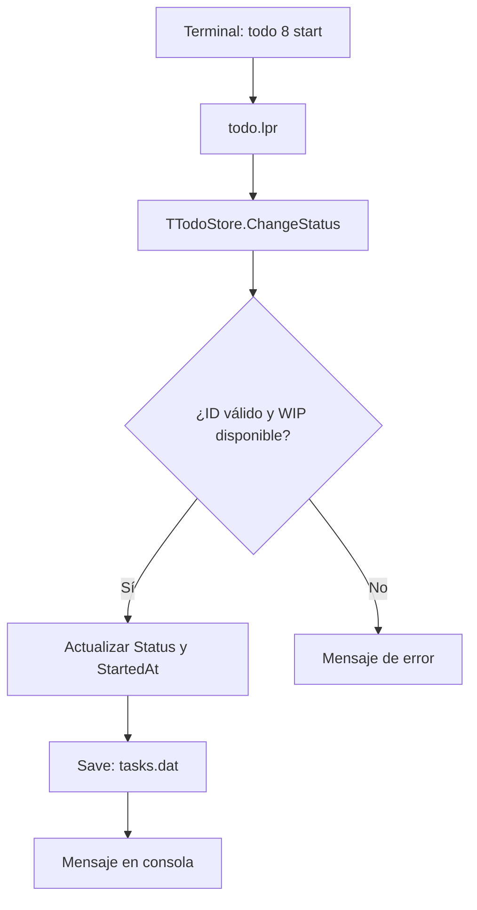
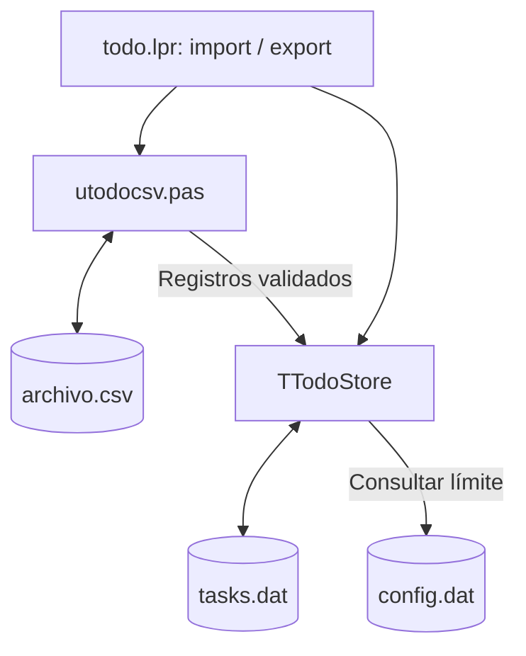
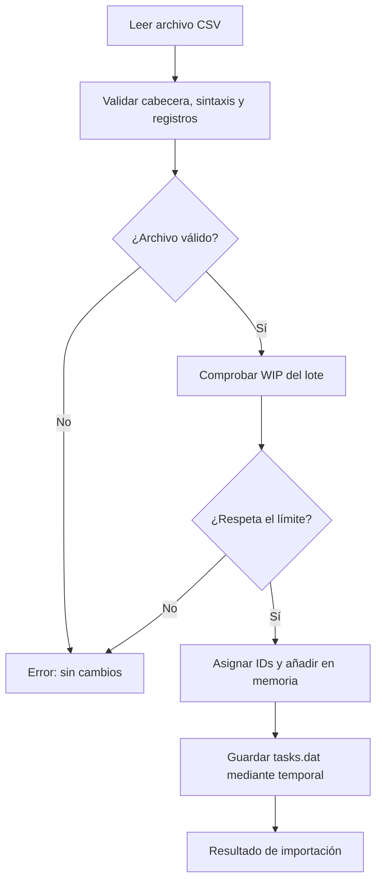

# Informe técnico: TODO Kanban (Free Pascal + Lazarus + Linux)

## 1. Objetivo y flujo general

TODO es un comando Linux que mantiene tareas en un archivo binario tipado. Cada ejecución carga las tareas en memoria, ejecuta la operación solicitada y, si hubo cambios, vuelve a guardar el estado completo en disco.

Flujo para `todo 8 start`:



La consola no manipula directamente el archivo. Todas las modificaciones pasan por `TTodoStore`.

## 2. Estados: modelo Kanban

- **CREADA**: registrada, todavía no planificada. Estado al ejecutar `add`.
- **PENDIENTE**: lista para abordarse.
- **EN TRABAJO**: en ejecución. Se admite hasta el límite WIP configurable (3 tareas por defecto).
- **COMPLETADA**: terminada.

Las transiciones pueden avanzar o retroceder. `move` permite elegir cualquier estado distinto del actual. `plan`, `start` y `ok` son atajos; `reopen` solo se admite desde COMPLETADA y vuelve a PENDIENTE. La comprobación WIP está en la clase de datos y se aplica independientemente del comando.

En una transición a EN TRABAJO, `StartedAt` recibe la fecha/hora **si todavía está a cero**: representa el primer comienzo, aunque luego vuelva a PENDIENTE. Al completar se registra `CompletedAt=Now`; al salir de COMPLETADA se borra `CompletedAt` para indicar que ya no está terminada.

Categoría, prioridad y estado son independientes. Una tarea de categoría `Redes` puede tener prioridad `Alta` y estado `CREADA`.

## 3. `src/utodotypes.pas`: tipos de datos

Define:

```pascal
TPriority = (prBaja, prMedia, prAlta);
TTaskStatus = (tsCreada, tsPendiente, tsEnTrabajo, tsCompletada);
```

Define dos registros:

```pascal
TTaskRecord = record
  ID: LongInt;
  Description, Category: string;
  CreatedAt, StartedAt, CompletedAt, DueAt: TDateTime;
  Priority: TPriority;
  Status: TTaskStatus;
end;
```

Este es el **modelo de memoria**: texto dinámico fácil de usar en Object Pascal, fechas `TDateTime` y enumerados legibles.

`TTaskDiskRecord = packed record ... end;` es el **modelo de almacenamiento**: sustituye las cadenas dinámicas por arrays de `AnsiChar` y los enumerados por `Byte`. Se puede guardar con `file of TTaskDiskRecord` porque no contiene cadenas administradas ni punteros a datos externos. Las funciones `EncodeTask` y `DecodeTask` traducen entre ambos modelos.

`packed record` evita bytes de relleno por alineación entre los campos. No hace que un `string` dinámico sea seguro para almacenamiento binario: por eso mantenemos la separación de registros.

Longitud en disco: ID (4) + descripción (2048) + categoría (64) + cuatro campos `Double` (4x8) + prioridad (1) + estado (1) = **2150 bytes** por registro. En el diseño se asume el tamaño habitual de `LongInt`, `Double` y `Byte` con FPC en Linux. El constructor lo comprueba con `SizeOf`.

La codificación del texto es UTF-8, y los máximos se expresan en bytes, no en caracteres.

## 4. `src/utodostore.pas`: POO y persistencia

La clase `TTodoStore` encapsula:

- `FItems`: array dinámico de `TTaskRecord`.
- `FNextID`: próximo identificador persistente.
- `FFileName`: ubicación del archivo de tareas.
- `FConfigFileName`: ubicación de `config.dat`.
- `FMaxWIP`: límite WIP vigente.

Funciones públicas: `Load`, `Count`, `Item`, `Find`, `Exists`, `Add`, `Edit`, `ChangeStatus`, `Complete`, `Reopen`, `CountByStatus`, `RemoveMany`, `SetWIP`, `ResetWIP`, `ImportTasks` y la propiedad `MaxWIP`.

Detalles del almacenamiento:

1. `Load` abre `tasks.dat` como archivo de registros, comprueba firma y versión, y reconstruye las tareas mediante `DecodeTask`.
2. El **registro 0** actúa como cabecera; no es una tarea. Guarda la firma `TODO-FPC-2`, versión 2 y el siguiente ID. Los registros restantes son tareas.
3. `Save` crea `tasks.dat.tmp`, escribe primero la cabecera y después todas las tareas, cierra y renombra el archivo temporal.
4. Los ID eliminados no se reutilizan, porque se conserva `FNextID`.
5. `RemoveMany` valida todos los ID antes de borrar ninguno y admite rangos procesados por el programa principal.

Este almacenamiento resulta didáctico por utilizar `AssignFile`, `Reset`, `Read`, `Rewrite`, `Write`, `FileSize`, `CloseFile` y una clase. **No es un motor de base de datos**: no maneja escrituras simultáneas, transacciones ACID ni recuperación tras cortes eléctricos.

## 5. `src/utodoconsole.pas`: interfaz textual

Es responsable de `PrintHelp`, `PrintList`, `PrintBoard`, `PrintDetail`, `PrintCategories`, `PrintStats`, `Prompt` y los mensajes.

El tablero agrupa las tareas en cuatro arrays por estado y dibuja columnas con el ID, prioridad, descripción abreviada y categoría. Usa secuencias de escape ANSI para colorear; `NO_COLOR=1` las desactiva. La presentación no cambia los registros de datos.

Los encabezados contienen caracteres UTF-8. `cwstring` en el programa principal habilita conversiones de codificación correctas en Linux, una corrección que ya fue necesaria durante las primeras pruebas con Lazarus.

## 6. `src/todo.lpr`: programa principal

Lee `ParamCount` y `ParamStr`. Comprueba los parámetros y llama a la clase o a la unidad de consola:

- `add` admite modo interactivo o argumentos directos.
- `ls` acepta estado opcional, filtro por categoría y filtro por prioridad.
- `board` presenta un resumen por columnas, opcionalmente filtrado por categoría.
- `move` y los atajos numéricos cambian estados.
- `rm` admite identificadores sueltos, rangos e ID separados por coma, con confirmación salvo `--yes`.
- `import` y `export` gestionan el intercambio CSV sin cambiar el almacenamiento principal.
- `wip`, `wip set N` y `wip reset` consultan y administran el límite persistente.
- `show`, `stats`, `cats`, `path` y `help` consultan datos. `path` y `help` pueden ejecutarse aunque el archivo de tareas todavía pertenezca a la versión anterior.

La gestión de excepciones presenta errores legibles y retorna código distinto de cero al shell.

## 7. Decisiones de diseño y límites

- Se ha **cambiado el formato a versión 2**. No se migran archivos de versiones anteriores porque estamos en pruebas.
- `ls` significa «no completadas»; `ls pendiente` se restringe al estado planificado.
- `StartedAt` mide la primera entrada en EN TRABAJO, no el tiempo total invertido.
- El límite WIP es configurable entre 1 y 1000, inicialmente 3; se guarda en `config.dat` y se valida en las transiciones e importaciones.
- Todas las transiciones explícitas son posibles; se rechaza intentar pasar al estado actual. `reopen` requiere COMPLETADA.
- El tablero tiene ancho fijo pensado para terminal grande; faltaría detectar ancho de terminal para adaptar la salida.
- No se implementa todavía undo, estados bloqueados, histórico de transiciones, locking ni integración con Lazarus LCL.

## 8. Aprendizaje sugerido

Primero estudiar los dos `record` y la conversión `EncodeTask`/`DecodeTask`. Después seguir `TTodoStore.ChangeStatus` y `Save`. Finalmente recorrer `todo.lpr` y comprobar cómo un mismo método atiende `todo N start` y `todo move N trabajo`.

En Lazarus, un punto de interrupción en `TTodoStore.ChangeStatus` permite inspeccionar `OldStatus`, `ANewStatus`, `FItems[I].StartedAt`, `CompletedAt` y el resultado de `CountByStatus`.


## 9. Feature 01: límite WIP configurable

El límite WIP ya no está fijado en las operaciones de cambio de estado. `todo wip` muestra límite, ocupación y plazas; `todo wip set N` admite valores de 1 a 1000 y `todo wip reset` recupera el valor inicial de 3. La configuración reside en `config.dat` como una línea `WIP=N`, junto a `tasks.dat` y sin modificar su formato binario. Si el WIP se reduce por debajo de la ocupación actual, se mantienen los estados y se bloquean nuevas entradas en trabajo hasta que haya capacidad.

## 10. Feature 02: importación y exportación CSV

### 10.1. Objetivo y límites

`todo export <ruta.csv>` vuelca todas las tareas y `todo import <ruta.csv>` añade tareas de otro archivo de intercambio. **CSV no sustituye la persistencia**: el almacenamiento principal sigue siendo `tasks.dat`, con cabecera `TODO-FPC-2` y formato 2. La configuración WIP continúa en `config.dat` y no forma parte del CSV. Importar no es restaurar una copia completa ni sincronizar dos almacenes.

### 10.2. Responsabilidades

- `src/utodocsv.pas`: serializa los campos, entrecomilla las cadenas cuando corresponde, lee CSV y valida sintaxis, cabecera, tipos y restricciones del modelo.
- `src/utodostore.pas`: `ImportTasks` valida el WIP de todo el lote, reasigna los identificadores, incorpora las tareas en memoria y efectúa un guardado; restaura el estado en memoria si la escritura falla.
- `src/todo.lpr`: reconoce los comandos `import` y `export`, valida sus argumentos y presenta los resultados o errores.
- `src/utodoconsole.pas`: documenta ambos comandos en la ayuda.
- `src/utodotypes.pas`: mantiene sin cambios los tipos y el formato binario.



### 10.3. Esquema del archivo

```csv
id;descripcion;categoria;fecha_creacion;fecha_inicio;fecha_finalizacion;fecha_vencimiento;prioridad;estado
1;Preparar laboratorio BGP;Redes;2026-10-27T11:45:09.874;2026-10-27T11:46:43.297;2026-10-27T11:47:22.094;;alta;ok
```

Codificación UTF-8, separador `;`, cabecera obligatoria y fechas con formato `YYYY-MM-DDTHH:MM:SS.mmm`. Una fecha opcional sin valor se escribe como campo vacío. Prioridades: `baja`, `media`, `alta`. Estados: `creada`, `pendiente`, `trabajo`, `ok`. Los campos de texto con comillas o `;` utilizan entrecomillado CSV con duplicación de comillas internas. Los campos `Description` y `Category` mantienen los límites del modelo (2047 y 63 bytes UTF-8), y no admiten NUL ni saltos de línea; el parser puede reconocer un campo CSV multilínea, pero la validación del modelo lo rechaza.

### 10.4. Semántica de importación

La columna `id` se valida como parte del archivo, pero el gestor asigna **identificadores nuevos** con su contador persistente. No se intenta deduplicar por descripción ni preservar los números originales. La importación añade tareas a las existentes, conserva fechas, prioridad, categoría, descripción y estado, y comprueba el WIP resultante antes de incorporar el lote. Ante un error de formato, fecha, prioridad, texto o WIP, se cancela el lote sin modificaciones. Reimportar un mismo CSV puede duplicar las tareas.



### 10.5. Exportación y seguridad de escritura

La exportación obtiene las tareas con `TTodoStore.Count` y `Item`, escribe primero `archivo.csv.tmp` y publica el resultado con un renombrado. Si el destino ya existe, rechaza la operación para evitar sobrescrituras accidentales. No modifica `tasks.dat` ni `config.dat`.

La persistencia habitual escribe `tasks.dat.tmp` antes de sustituir `tasks.dat`. Esta protección ante una escritura incompleta no equivale a una transacción ACID: no hay bloqueo entre procesos ni sincronización explícita a disco (`fsync`). Dado el alcance local y personal del proyecto, se mantiene conscientemente esa limitación sin ampliar la Feature 02.

### 10.6. Pruebas realizadas

- Compilación satisfactoria con FPC 3.2.2; permanecen tres advertencias de compilación/enlace ya conocidas.
- Exportación e importación de 11 tareas usando `XDG_DATA_HOME` aislado.
- Exportación posterior idéntica a la original salvo por reasignación de IDs (un hueco original entre 7 y 9 se compactó).
- Rechazo de importación al exceder WIP (4 frente a máximo 3), sin cambios de SHA-256 en `tasks.dat`.
- Rechazo de prioridad inválida en la fila 3 sin aplicación parcial y con SHA-256 idéntico.
- Comillas escapadas, punto y coma y caracteres UTF-8 conservados en exportación e importación.
- Rechazo explícito de una descripción con saltos de línea, manteniendo 12 tareas.

La Feature 02 no cambia `FILE_MAGIC`, `FILE_FORMAT_VERSION` ni `TTaskDiskRecord`.
